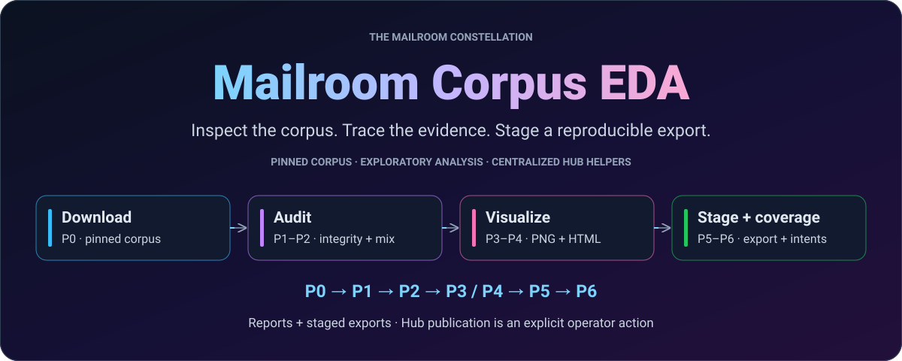

<div align="center">

<picture>
  <source media="(max-width: 640px)" srcset="docs/assets/readme/hero-mobile.svg"/>
  
</picture>

# Mailroom Corpus EDA

[](pyproject.toml)
[](src/mailroom_eda/config.py)
[](run_all.py)
[](https://huggingface.co/datasets/Lucius-Morningstar/mailroom-dataset)

**[Quickstart](#quickstart)** · **[How it works](#how-it-works)** · **[Corpus](#corpus-at-a-glance)** · **[Reports](#reports)** · **[Publishing](#hf-hub-interface)**

</div>

---

## What this does

The corpus analysis and publishing source for the Mailroom constellation:
inspect document composition and provenance, identify quality gaps, produce
static and interactive reports, and stage cast-safe exports through the
centralized Hugging Face helpers.

The loader pins **mailroom-dataset v9.2**: tag/card commit `670e8bc6`, data
commit `d49f60a4`, **3,302 documents across five classes and 55 strata**.
The pin is defined in [`src/mailroom_eda/config.py`](src/mailroom_eda/config.py);
consumer repositories keep their own explicit revisions. The frozen v8
[`mailroom-corpus`](https://huggingface.co/datasets/Lucius-Morningstar/mailroom-corpus)
baseline remains a separate dataset.

Browse the committed [summary](reports/SUMMARY_REPORT.md) and
[interactive report site](https://exios66.github.io/Mailroom-Corpus-EDA/)
without rebuilding the analysis. This project is a virtual, nonbuilt uv
member when imported into Digital-Mailroom; its source repository owns the
analysis and publication helpers.

<div align="center">

</div>

## Quickstart

<a id="quick-start"></a>

The project declares Python **3.12+**. Its pinned standalone
[`requirements.txt`](requirements.txt) targets **Python 3.13**; use that
interpreter for the reproducible setup below.

```bash
git clone https://github.com/Exios66/Mailroom-Corpus-EDA.git
cd Mailroom-Corpus-EDA
python3.13 -m venv .venv
.venv/bin/python -m pip install -r requirements.txt

# Read-only command discovery, then download the pinned public corpus.
.venv/bin/python run_all.py --help
.venv/bin/python run_all.py --phases P0

# Full analysis writes local reports and staged exports; it does not publish.
.venv/bin/python run_all.py

# Once data exists, regenerate just the figures (comma-separated phases).
.venv/bin/python run_all.py --phases P3,P4
```

Public corpus reads do not require `HF_TOKEN`. Publication is a separate,
explicit operation. `data/` is gitignored; `reports/` contains committed
canonical results. Interactive Plotly HTML includes per-render UUIDs, so
inspect regenerated figures as scratch output rather than replacing the
committed reports incidentally.

## Corpus at a Glance

<div align="center">

| Metric | Value |
|:---|:---|
| **Documents** | 3,302 |
| **Doc Types** | 5 (insurance_claim, contract, correspondence, merger_agreement, corporate_record) |
| **Strata** | 55 |
| **Imbalance Ratio** | 7.2× |
| **CUAD Spans** | 13,753 |
| **Offset Match** | 100% |

</div>

<div align="center">

| Class | Count | % |
|:---|---:|---:|
| `insurance_claim` | 1,100 | 33.3% |
| `correspondence` | 1,000 | 30.3% |
| `contract` | 600 | 18.2% |
| `corporate_record` | 450 | 13.6% |
| `merger_agreement` | 152 | 4.6% |

</div>

## How it works

<a id="pipeline-run_allpy"></a>

`run_all.py` executes seven phases. Reports and exports remain local unless
you invoke a publishing command explicitly.


<div align="center">

| Phase | What | Output |
|:---|:---|:---|
| **P0** | Corpus download + manifest validation | `data/parquet/**` |
| **P1** | Structural integrity & provenance audit | `reports/tables/integrity_report.json` |
| **P2** | Composition: strata, imbalance, provenance | `strata_counts.csv`, `imbalance_metrics.json` |
| **P3** | Static PNG figures + EDA tables | `reports/figures/`, `reports/tables/` |
| **P4** | Interactive Plotly HTML figures | `reports/figures_interactive/` |
| **P5** | Cast-safe JSONL + parquet staging helpers | `data/staging/` |
| **P6** | Correspondence intent coverage & provenance audit | `reports/SUMMARY_REPORT.json` |

</div>

Only a complete, error-free seven-phase run writes `reports/SUMMARY_REPORT.json`.
Subset runs and `--no-interactive` leave the full summary untouched.

## Reports

| Artifact | Description |
|:---|:---|
| [`reports/SUMMARY_REPORT.md`](reports/SUMMARY_REPORT.md) | Narrative summary of all findings |
| [`reports/figures/`](reports/figures/) | 30 static PNGs (text/token, CUAD, MAUD, claims, correspondence, imbalance, temporal, metadata) |
| [`reports/figures_interactive/`](reports/figures_interactive/) | 18 Plotly HTML figures |
| [`reports/tables/`](reports/tables/) | CSV/JSON tables |

## Dataset Cards

Per-source documentation for the corpora integrated into [`mailroom-dataset`](https://huggingface.co/datasets/Lucius-Morningstar/mailroom-dataset) lives in [`docs/dataset-cards/`](docs/dataset-cards/):

| Corpus | Doc Type | Count | Card |
|:---|:---|---:|:---|
| CUAD contracts + SEC EDGAR EX-10 | `contract` | 600 | [View →](docs/dataset-cards/cuad-contracts.md) |
| MAUD merger agreements | `merger_agreement` | 152 | [View →](docs/dataset-cards/maud-merger-agreements.md) |
| S-1 + EDGAR corporate records | `corporate_record` | 450 | [View →](docs/dataset-cards/s1-corporate-records.md) |
| Enron correspondence | `correspondence` | 1,000 | [View →](docs/dataset-cards/enron-correspondence.md) |
| CMS DE-SynPUF + GNOTHEIA + BDR + INSURBIAS insurance claims | `insurance_claim` | 1,100 | [View →](docs/dataset-cards/cms-desynpuf-insurance-claims.md) |

## HF Hub Interface

The upload/publish helpers previously living in `llm-entity-extraction` (pruned from the monorepo in DMR-079; standalone repo only) are centralized here:

| Module | Purpose |
|:---|:---|
| `src/mailroom_eda/hf_interface.py` | Hub client (upload, sha256 verify, repo mgmt) |
| `src/mailroom_eda/dataset_export.py` | Cast-safe metadata (KANBAN-076), JSONL line-boundary safety (KANBAN-088), parquet staging |
| `src/mailroom_eda/docclass_uploader.py` | Docclass v7 publish, surgical card rendering, blind-label strip, GT leak guard |
| `src/mailroom_eda/intent_backfill.py` | Correspondence intent hydration (issue #5): cross-walk, Enron/AESLC sha256 join, LLM pass |
| `src/mailroom_eda/token_budget.py` | Token estimation & budget coverage |

### CLI Commands

<details>
<summary>v9 build/publish, intent backfill & verification</summary>

```bash
# v9 mailroom-dataset build — stage-only by default
.venv/bin/python scripts/build/build_v9.py

# ...and publish to https://huggingface.co/datasets/Lucius-Morningstar/mailroom-dataset
HF_TOKEN=hf_... .venv/bin/python scripts/build/build_v9.py --publish

# Correspondence intent backfill (issue #5; needs OPENROUTER_API_KEY for LLM pass)
.venv/bin/python scripts/backfill/backfill_intent.py --check
.venv/bin/python scripts/backfill/backfill_intent.py --join-only
.venv/bin/python scripts/backfill/backfill_intent.py            # full Phases 1-5

# Byte-verify a local export against the Hub
.venv/bin/python scripts/publish/verify_hf.py --repo Lucius-Morningstar/mailroom-dataset \
    --jsonl data/ground_truth_hardened.jsonl
```

</details>

> Frozen v8 tooling (build_v8 / publish_hardened / reconcile_gt_v8 /
> publish_docclass / export_docclass) is archived under
> `scripts/archive/v8/`; the one-time v9 EDGAR/draw sourcing lives under
> `scripts/archive/v9-acquisition/`. See [the script index](scripts/README.md).

## Key Findings

- **Merger agreements are longest**: mean ~89k chars ≈ 22k tokens (heuristic) — **max ~252k chars ≈ 63k heuristic tokens**; budget for the actual tokenizer, prompt overhead and output, and chunk long agreements where needed
- **Insurance claims uniformly short**: ~690 chars, σ=953 — six LOB subtypes (carrier/inpatient/outpatient/pde + property/auto)
- **Token budget**: 77% ≤4k, 90% ≤16k, 93% ≤32k, 99.8% ≤131k
- **CUAD**: 509 annotated contracts × 41 clause types; 13,753 spans, 100% exact offset (91 v9 EX-10 contracts carry no CUAD spans)
- **MAUD**: 152 agreements × 22 tasks; 3 tasks annotated on every agreement
- **Insurance**: 13/13 fields 100% filled; coverage determination fully populated
- **Correspondence**: intent 100% hydrated (1,000/1,000, four provenance paths incl. v9 `heuristic`); sentiment-labeled subset

## Publishing contracts

All Hub writes go through `mailroom_eda.hf_interface`, `dataset_export` and
the version-specific builders. Preserve uniform string metadata, JSONL line
boundaries, blind-config label separation, revision pins and SHA-256 checks.
Use the [script index](scripts/README.md) and
[revision plans](docs/plans/) for the exact build and publish sequence;
legacy v8 helpers target the frozen baseline, not the v9 dataset by default.

## Testing and documentation

```bash
.venv/bin/python -m pip install "pytest>=8.0"
.venv/bin/python -m pytest tests/
```

Full-corpus tests need the P0 snapshot. Taxonomy integration tests also need
the sibling llm-mailroom checkout described in [AGENTS.md](AGENTS.md); these
are not dependency-free tests. For the read-only corpus coverage audit:

```bash
.venv/bin/python scripts/audit/coverage_matrix.py --check
```

| Reference | Purpose |
| :--- | :--- |
| [Dataset cards](docs/dataset-cards/) | Sources, annotations and licenses |
| [Summary report](reports/SUMMARY_REPORT.md) | Committed findings and corpus counts |
| [Scripts](scripts/README.md) | Build, audit, backfill and verification commands |
| [Agent and contributor rules](AGENTS.md) | Publishing, determinism and report policy |

---

<div align="center">

**[Digital-Mailroom](https://github.com/LLM-Mailroom-Services/Digital-Mailroom)** ·
**[llm-mailroom](https://github.com/Exios66/llm-mailroom)** ·
**[llm-dojo-scoring](https://github.com/Exios66/llm-dojo-scoring)** ·
**[The-Mailroom](https://github.com/Exios66/The-Mailroom)** ·
**[local-mailroom-sandbox](https://github.com/Exios66/local-mailroom-sandbox)** ·
**[Mailroom-Corpus-EDA](https://github.com/Exios66/Mailroom-Corpus-EDA)** ·
**[mailroom-ml](https://github.com/LLM-Mailroom-Services/mailroom-ml)**

<sub>The Mailroom constellation · independent source repositories, shared interfaces.</sub>
<br/>
<sub>Core packages integrate in Digital-Mailroom; mailroom-ml is a standalone contractor.</sub>
<br/>
<sub>Local artwork: <a href="docs/assets/readme/README.md">design and regeneration</a>.</sub>

</div>
